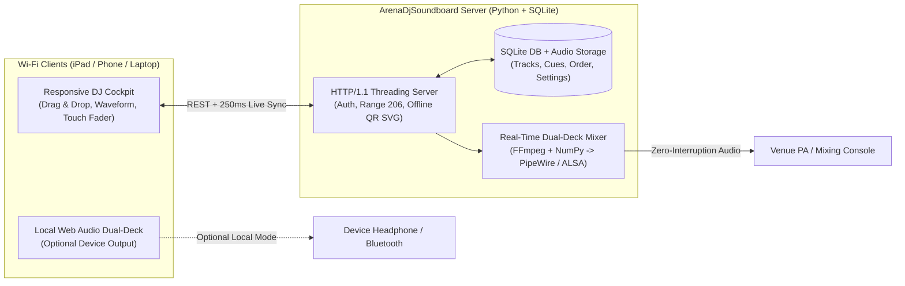

# 🎧 ArenaDjSoundboard

**ArenaDjSoundboard** is a web-based live DJ soundboard and dual-deck audio mixer purpose-built for **sports competitions, stadium announcements, and live events**.

Designed for effortless touch control on **iPads, smartphones, and laptops**, it lets event DJs play music between athletes, jump straight to numbered song highlights (`1`, `2`, `3`, ...), crossfade tracks seamlessly, duck music for announcer voiceovers, and control a central hall PA system wirelessly over Wi-Fi.

---

## ✨ Key Features

* **🎯 Numbered Highlight Cue Points & Waveform Editor**
  * Visually scrub through an interactive audio waveform to mark multiple highlights (drops, choruses, intros, fanfares) per track.
  * Launch highlights instantly via compact numbered pads (`1`, `2`, `3`, ...), each with its own custom color, optional end-time, and individual Fade-In vs. Instant-Drop mode.
* **🔀 Dual-Deck Equal-Power Crossfade & Auto-Next**
  * Automatically blends outgoing and incoming tracks smoothly across two parallel audio decks (configurable crossfade duration, e.g. `4.0s`).
  * Supports one-tap endless track/section looping (`🔁 Loop`) and automatic playlist follow-scrolling (`🎯 Auto-Follow`) so the active track always stays centered in view.
* **🔊 Switchable Audio Output (Reload-Proof!)**
  * **Server Soundcard Mode (`🔊 Server-Ton`):** Runs a real-time Python/NumPy dual-deck PCM mixer (`ffmpeg` → PipeWire `pw-play` / ALSA `aplay` / `ffplay`) directly on the host machine connected to the venue PA mixer. Reloading or closing browsers on any iPad, phone, or laptop **never** interrupts live playback.
  * **Device Browser Mode (`📱 Gerät-Ton`):** Routes audio locally via the **Web Audio API (`GainNode`)** so virtual volume faders and smooth fades work even on iOS/iPadOS Safari—complete with pull-to-refresh prevention, reload warnings, and automatic timestamp resume.
* **🎚️ Vertical Studio Master Fader & Talkover Ducking**
  * Touch-locked vertical mixing console fader (`touch-action: none`) with live output metering and quick-level presets (`100%` down to `0%`).
  * **One-Tap Talkover (`🎤`):** Smoothly ducks the music (e.g., to `20%`) for live stadium/hall announcer voiceovers and glides back up on release.
  * **Smooth Fade-Out (`📉`):** Gently fades out the music whenever the next athlete steps up.
* **🧩 Modular Drag-and-Drop DJ Cockpit & Full Mobile Responsiveness**
  * **3-Column Cockpit** (`Songs & Highlights` | `Master Fader` | `Now Playing Deck`)—rearrangeable live via touch/mouse Drag & Drop with smooth FLIP animations.
  * Switch between **Grid Cards (`▦`)** and a **Compact List View (`☰`)**, and reorder tracks via Drag & Drop.
  * Dedicated thumb-friendly **Mobile Bottom DJ Dock** on smartphones and portrait tablets.
* **🔒 Protected Wi-Fi Remote Access (Offline QR Code + Token & PIN)**
  * Built-in zero-dependency ISO/IEC 18004 SVG QR code generator—scan once with an iPad or phone camera in the venue Wi-Fi (even with zero internet access) for instant 30-day authenticated `HttpOnly` session access, or log in via custom password/PIN with brute-force rate limiting.
* **🔄 Built-in GitHub Update Checker & One-Click Updater**
  * Check directly inside **`⚙️ Einstellungen`** whether a newer version is available on GitHub and install updates with a single click—automatically restarting the server if needed while keeping all uploaded audio files, cue points, and database settings untouched.
* **💾 Persistent SQLite Storage**
  * All uploaded audio files, categories, track order, cue points, waveform peaks, and mixer settings are stored persistently on the server for future competitions.

---

## 🏗️ Architecture



---

## 🚀 Quick Start

### Prerequisites
* **Python 3.10+** (uses Python's standard library for HTTP, SQLite, and crypto)
* **FFmpeg** (`ffmpeg` & `ffprobe` for fast waveform peak extraction and server-side decoding)
* **NumPy** (`python3-numpy` / `pip install numpy`) + **PipeWire (`pw-play`)**, **ALSA (`aplay`)**, or **`ffplay`** (for central `Server-Ton` PA output)

### Run the Server

```bash
git clone https://github.com/uWiiiDev/ArenaDjSoundboard.git
cd ArenaDjSoundboard
./start.sh
```

*(Or run `python3 server.py` directly. Set `PORT=8080` to customize the port.)*

On first startup, the server initializes `data/arena_dj.db` (excluded from Git), prints the local URL, the protected Wi-Fi URL, a secret iPad magic link, and an initial 6-digit PIN:

1. Open `http://localhost:8080` on the host computer.
2. Click **`➕ MP3 Upload`** to add your own competition tracks (`.mp3`, `.wav`, `.m4a`, `.ogg`, `.flac`).
3. Click **`✂️`** on any track to open the **Waveform Editor** and drop numbered highlights (`1`, `2`, `3`, ...).
4. Click **`⚙️ Einstellungen`** to scan the offline QR code with your iPad or smartphone, set your own password/PIN, or check for GitHub updates.

---

## 📂 Project Structure

```text
ArenaDjSoundboard/
├── server.py         # Multi-threaded HTTP server, REST API, HTTP 206 Range streaming & Auth
├── server_audio.py   # Real-time dual-deck server PCM mixer (Crossfade, Fader, Talkover)
├── qr_svg.py         # Pure-Python offline ISO/IEC 18004 QR code SVG generator
├── start.sh          # Convenience startup script
└── static/
    ├── index.html    # 3-column modular DJ cockpit & modals
    ├── login.html    # Password / PIN lock screen for Wi-Fi clients
    ├── styles.css    # Responsive dark arena UI, vertical studio fader & mobile dock
    └── app.js        # Dual-mode controller, Web Audio dual-deck engine & FLIP drag-and-drop
```

> **Note on Copyright & Privacy:** The `data/` directory (uploaded MP3s and local SQLite database containing session secrets) is excluded via `.gitignore` and is never committed to version control.
